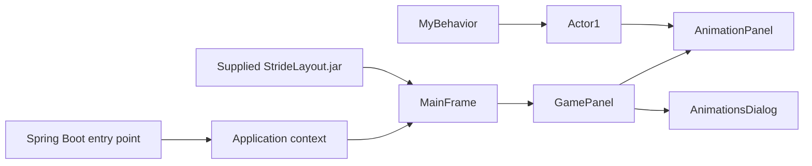

# Java Animation Platform (CSS 490 coursework)

A Java 21 desktop animation/game project built with Swing and Spring Boot. It explores actor behavior, frame-based rendering, UI dialogs, and application lifecycle wiring.

## Ownership and supplied code

This is coursework, not a from-scratch UI framework. `lib/StrideLayout.jar` is a supplied third-party/course library consumed as a system-scoped Maven dependency. The Java code under `src/main/java/com/mrstride/`, application resources, and submitted design artifacts are the implementation in this repository. No claim is made to authorship of the bundled JAR.

## Structure

```text
src/main/java/com/mrstride/
├── Main.java                    Spring Boot entry point
├── Actor1.java                  Actor state and animation data
├── MyBehavior.java              Actor behavior
├── ApplicationContextProvider.java
└── gui/
    ├── MainFrame.java           Top-level Swing window
    ├── GamePanel.java           Game composition
    ├── AnimationPanel.java      Rendering surface
    └── AnimationsDialog.java    Animation controls
```



## Run

Requirements: JDK 21. The Maven wrapper is included.

```bash
./mvnw spring-boot:run
```

On Windows: `.\mvnw.cmd spring-boot:run`.

## Design artifacts

Assignment notes, UI mockups, and Draw.io entity diagrams live under `src/main/resources/designs/`. They document the coursework process but are not runtime dependencies.

## Limitations

- The supplied layout JAR is checked in and referenced with Maven `systemPath`, reducing portability.
- Test dependencies exist but no automated tests are committed.
- The app targets desktop Swing and is not documented as cross-platform beyond Java runtime portability.
- This is an educational project rather than a maintained production library.
